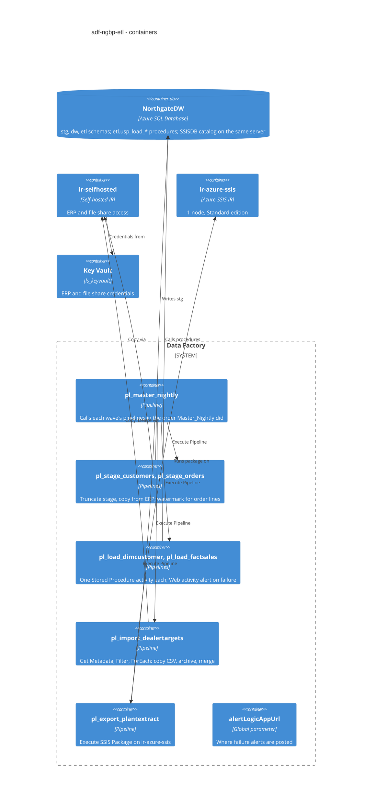
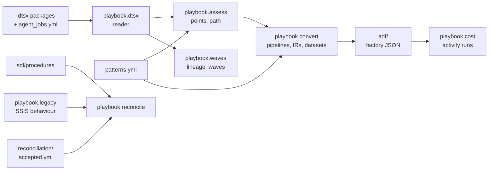

# Containers

## The factory

## The playbook

How the tools in this repository feed each other.

`adf/` is generated: `make convert` rewrites it, and a test fails if the
committed files differ from what the converter produces. Hand changes belong
in the converter or in `patterns.yml`.
