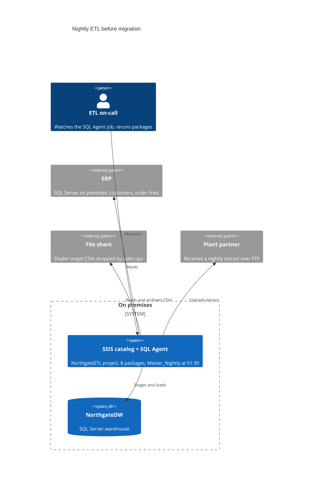
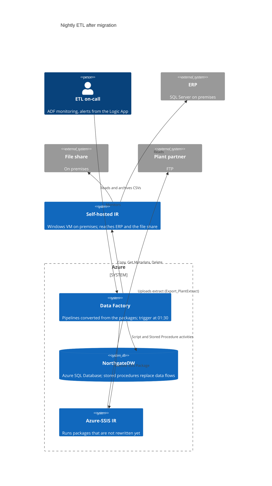

# Context

Northgate Building Products is fictional. The SQL Server names in the sample
packages (ERPSQL01, DWSQL01, fileshare01) and the Azure resource names in
`adf/` are made up.

## Before

## After

